  

# Awesome Terminal Emulators & Text Interfaces (TUI) ⚡

> A curated directory of premier **GPU-accelerated terminal emulators**, **cross-platform multiplexers**, **Terminal User Interface (TUI) applications**, and **command-line developer tools**. Explore hardware-rendered shells, Sixel/Kitty graphics, and cloud-synced terminal infrastructure.

---

## 📑 Table of Contents
- [Sector Overview & Market Dynamics](#-sector-overview--market-dynamics)
- [SaaS & Commercial Hosted Platforms](#-saas--commercial-hosted-platforms)
- [Open-Source GitHub Projects](#-open-source-github-projects)
  - [Terminal Emulators & Multiplexers](#-terminal-emulators--multiplexers)
  - [Interactive TUI Applications & Frameworks](#-interactive-tui-applications--frameworks)
- [How to Contribute](#-how-to-contribute)
- [Support](#-support)
- [Star History](#-star-history)
- [Disclaimer](#-disclaimer)

---

## 📊 Sector Overview & Market Dynamics

The global developer tools and terminal interface software market is estimated at **$4.8 billion in 2026**, growing at a 14.2% CAGR driven by cloud infrastructure operations, containerized Kubernetes workflows, and developer productivity tooling. The terminal emulator and command-line interface sector is **moderately fragmented**: commodity platform default terminals (Apple Terminal, basic GNOME Terminal) face fierce competition from high-performance hardware-rendered emulators (GPU shaders, Zig/Rust engines), while enterprise remote access and AI-integrated cloud terminals exhibit selective network effects and high switching costs around encrypted team vaults and shared session workflows.

---

## 💼 SaaS & Commercial Hosted Platforms

| Product | Valuation / Revenue | Starting Tier Pricing | Free Tier / Trial Limit | Key Features |
| :--- | :--- | :--- | :--- | :--- |
| **[VanDyke SecureCRT](https://vandyke.com)** | **$55M Annual Revenue** | **$109.00 / license** (1-year updates & support) | **30-day fully functional evaluation trial** (unlimited sessions during trial) | Enterprise-grade SSH/Telnet terminal client with FIPS 140-2 encryption, multi-session tabs, and automated VBScript/Python scripting. |
| **[Termius](https://termius.com)** | **$35M Valuation** ($8M ARR) | **$10.00 / month** (billed annually at $120/yr for Pro) | **Free forever plan** (single device, unlimited SSH connections, local host storage; 14-day Pro trial with zero credit card) | Cross-platform SSH, Mosh, and SFTP terminal client offering zero-knowledge encrypted vault synchronization, team snippet sharing, and iOS/Android/Desktop parity. |
| **[Warp](https://warp.dev)** | **$30M Valuation** (Series A funded by GV) | **$15.00 / user / month** (billed annually for Warp Team) | **Free forever plan** (up to 3 team members, full terminal capabilities, 100 AI request credits per month) | Modern GPU-rendered terminal built in Rust featuring native IDE-like text editing, block-based command execution, collaborative notebooks, and embedded AI command agents. |
| **[ZOC Terminal](https://emtec.com)** | **$12M Valuation** ($3M ARR) | **$79.99 / single-user license** (lifetime major version) | **30-day full-feature trial** (unrestricted sessions and terminal emulations) | Professional SSH, Telnet, and serial terminal emulator for macOS & Windows with VT220/TN3270 emulation, automated REXX scripts, and tabbed administration. |
| **[Tabby Sync Cloud](https://tabby.sh)** | **$6M Valuation** (Indie SaaS / Open-Core) | **$3.50 / month** (or self-hosted sync server) | **Free forever plan** (unlimited local sessions, community sync server support, free web app client) | Cloud configuration vault and remote profile sync engine for the open-source Tabby terminal emulator, orchestrating SSH keys and connection tabs across multiple workstations. |
| **[Wave Terminal Cloud](https://waveterm.dev)** | **$5M Valuation** (Seed stage) | **$12.00 / user / month** (Enterprise Cloud workspaces) | **Free forever plan** (open-core desktop app, local AI integration, unlimited terminal blocks, standalone previewers) | AI-native open-core terminal application pairing inline web renders, markdown previewers, and visual directory file exploration alongside rich terminal shells. |

---

## 🚀 Open-Source GitHub Projects

Curated open-source terminal emulators, multiplexers, and interactive text user interfaces, sorted descending by GitHub community popularity and Stars_Count.

### 🖥️ Terminal Emulators & Multiplexers

| Repository | Community GitHub_Stars | Language | Primary Architecture & Description |
| :--- | :--- | :--- | :--- |
| **[microsoft/terminal](https://github.com/microsoft/terminal)** |  | C++ / C# | Official Windows Terminal engine featuring DirectX/DirectWrite GPU text rendering, dynamic tabs, split panes, quake window mode, and deep WSL2/PowerShell integration. |
| **[Eugeny/tabby](https://github.com/Eugeny/tabby)** |  | TypeScript | Infinite-customization cross-platform terminal and serial console with embedded SFTP client, SSH profile manager, and extensible web plugin ecosystem. |
| **[alacritty/alacritty](https://github.com/alacritty/alacritty)** |  | Rust | Blazing-fast, OpenGL-accelerated minimalist terminal emulator engineered for minimal latency, zero overhead, and clean declarative TOML configuration. |
| **[ghostty-org/ghostty](https://github.com/ghostty-org/ghostty)** |  | Zig | Fast, native, GPU-accelerated terminal emulator utilizing platform-native graphical toolkits, font shaders, Kitty graphics, and embeddable `libghostty` primitives. |
| **[tmux/tmux](https://github.com/tmux/tmux)** |  | C | The industry-standard terminal multiplexer enabling persistent detached sessions, flexible split-window panes, and remote workstation workflow orchestration. |
| **[vercel/hyper](https://github.com/vercel/hyper)** |  | TypeScript | Electron-powered extensible terminal emulator built upon web standards (HTML, CSS, JS), supporting seamless theme styling and modular npm extension plugins. |
| **[zellij-org/zellij](https://github.com/zellij-org/zellij)** |  | Rust | Batteries-included terminal workspace and multiplexer with auto-tiling layouts, floating panes, session resurrection, and WebAssembly plugin runtime. |
| **[kovidgoyal/kitty](https://github.com/kovidgoyal/kitty)** |  | C / Python | Feature-rich GPU terminal emulator offloading rendering to OpenGL; pioneering the Kitty Graphics Protocol, programmable kitten sub-tools, and ligatures. |
| **[wez/wezterm](https://github.com/wez/wezterm)** |  | Rust | GPU-accelerated cross-platform terminal emulator and multiplexer configured via Lua, supporting native SSH domains, color glyphs, and Sixel graphics. |
| **[Swordfish90/cool-retro-term](https://github.com/Swordfish90/cool-retro-term)** |  | C++ / QML | Hardware-accelerated terminal emulator with customizable CRT scanlines, phosphor bloom, curvature distortions, and retro amber/green monochrome palettes. |
| **[xtermjs/xterm.js](https://github.com/xtermjs/xterm.js)** |  | TypeScript | Front-end terminal component powering VS Code, Hyper, and cloud web consoles with high-throughput Canvas/WebGL rendering and POSIX terminal compatibility. |
| **[gnachman/iTerm2](https://github.com/gnachman/iTerm2)** |  | Objective-C | Comprehensive macOS terminal emulator featuring shell integration, split panes, instant replay, dynamic color profiles, and Python automation API. |
| **[raphamorim/rio](https://github.com/raphamorim/rio)** |  | Rust | Next-generation hardware-accelerated terminal emulator powered by `wgpu`, operating natively on desktop and inside browsers via WebAssembly. |
| **[gnunn1/tilix](https://github.com/gnunn1/tilix)** |  | D / GTK3 | Advanced tiling terminal emulator for Linux compliant with GNOME HIG, supporting drag-and-drop panes, quake drops, and synchronized terminal typing. |
| **[contour-terminal/contour](https://github.com/contour-terminal/contour)** |  | C++20 | Modern terminal emulator built with C++20 and OpenGL supporting VT520/xterm compliance, Sixel graphics, clickable hyperlinks, and unicode bidirectional text. |
| **[sedwards2009/extraterm](https://github.com/sedwards2009/extraterm)** |  | TypeScript | Modular terminal emulator introducing isolated output frames, inline image previews, command output filtering, and text manipulation buffers. |
| **[gnome-terminator/terminator](https://github.com/gnome-terminator/terminator)** |  | Python | Robust grid-based terminal layout manager for Linux desktops allowing infinite split panels, simultaneous keystroke broadcasting, and tab saving. |
| **[KDE/konsole](https://github.com/KDE/konsole)** |  | C++ | Flagship terminal emulator for the KDE desktop ecosystem offering tabbed browsing, bookmarkable SSH remote sessions, and embeddable KPart widgets. |

---

### 🎛️ Interactive TUI Applications & Frameworks

| Repository | Community GitHub_Stars | Language | Primary Architecture & Description |
| :--- | :--- | :--- | :--- |
| **[junegunn/fzf](https://github.com/junegunn/fzf)** |  | Go | Interactive command-line fuzzy finder and TUI filter used universally for files, commit histories, processes, and command completions. |
| **[sharkdp/bat](https://github.com/sharkdp/bat)** |  | Rust | Enhanced `cat` clone with syntax highlighting for 100+ languages, Git line modifications, automatic paging, and terminal display formatting. |
| **[starship/starship](https://github.com/starship/starship)** |  | Rust | Ultra-fast, customizable, cross-shell prompt displaying git state, programming runtimes, battery levels, and cloud context with zero latency. |
| **[charmbracelet/bubbletea](https://github.com/charmbracelet/bubbletea)** |  | Go | Modern The Elm Architecture (TEA) framework for writing elegant, composable, and reactive terminal user interfaces in Go. |
| **[sxyazi/yazi](https://github.com/sxyazi/yazi)** |  | Rust | Blazing-fast asynchronous TUI file manager with non-blocking I/O, built-in code/image previews, and multi-tab directory navigation. |
| **[p-e-w/heretic](https://github.com/p-e-w/heretic)** |  | Python | Interactive text interface and CLI tool for training-free directional ablation and language model optimization. |
| **[vadimdemedes/ink](https://github.com/vadimdemedes/ink)** |  | TypeScript | React component renderer for command-line interfaces; build interactive CLI tools using Yoga Flexbox layout and React hooks. |
| **[Textualize/textual](https://github.com/Textualize/textual)** |  | Python | Rapid application development TUI framework for Python with a modern CSS styling engine, mouse support, smooth animations, and web export. |
| **[dandavison/delta](https://github.com/dandavison/delta)** |  | Rust | Syntax-highlighting pager for git, diff, and grep output with side-by-side view, line numbers, and intra-line word-level change highlights. |
| **[atuinsh/atuin](https://github.com/atuinsh/atuin)** |  | Rust | Magical shell history manager substituting default Ctrl-R with an interactive SQLite-backed TUI and end-to-end encrypted device synchronization. |
| **[eza-community/eza](https://github.com/eza-community/eza)** |  | Rust | Modern, feature-rich replacement for `ls` displaying file types, permissions, git status indicators, tree views, and extended metadata. |
| **[ratatui/ratatui](https://github.com/ratatui/ratatui)** |  | Rust | Lightweight, high-performance Rust library for cooking up rich terminal user interfaces, widgets, canvas charts, and layout structures. |
| **[ClementTsang/bottom](https://github.com/ClementTsang/bottom)** |  | Rust | Graphical cross-platform system monitor TUI featuring real-time CPU, memory, disk, network, and process graphs with customizable themes. |
| **[dalance/procs](https://github.com/dalance/procs)** |  | Rust | Modern replacement for `ps` delivering colored tabular output, tree views, human-readable units, multi-column search, and Docker container inspection. |

---

## 🤝 How to Contribute

We welcome contributions from the developer community! Follow these steps to submit additions or updates:

1. 🍴 **Fork the repository** to your GitHub account.
2. 🌿 **Create a feature branch**: `git checkout -b add-terminal-tool`.
3. 📝 **Edit `README.md`**: Follow the existing Markdown table formats.
   - For SaaS tools: Include verified pricing, free tier/trial boundaries, and company valuation/revenue metrics.
   - For Open-Source: Include the official GitHub repository link and shield badge (`style=social&color=white`) linking to `/stargazers`.
4. 🧪 **Validate links and formatting**: Ensure all markdown links resolve correctly.
5. 🚀 **Submit a Pull Request** with a concise description of the added tool and its primary use case.

---

## 💖 Support

Thank you for visiting and supporting the **Awesome Terminal Emulators & Text Interfaces** project! 🌟

If you find this curated collection helpful for your daily developer workflow, system administration, or command-line productivity:
- ⭐ **Star this repository** to help others discover it across GitHub.
- 🍴 **Fork and contribute** your favorite terminal tools, emulators, and TUI applications.
- 📢 **Share** with friends, colleagues, and developer communities.
- ☕ **Buy a coffee & sponsor**: Support ongoing research, updates, and ecosystem maintenance via the [GitHub Sponsors Dashboard](https://github.com/sponsors/ishandutta2007).

---

## 📈 Star History

---

## 🔒 Disclaimer

- This repository is a **curated educational resource**; inclusion does not constitute commercial endorsement or warranty.
- Terminal emulators and TUI utilities execute shell binaries with user OS permissions. Regularly update packages to safeguard against escape-sequence injection and remote code execution vulnerabilities.
- When utilizing cloud terminal vaults or remote SSH synchronization tools, ensure end-to-end encryption (E2EE) is activated and multi-factor authentication (MFA) is enforced.

---

  <b>Built with 💻 for terminal enthusiasts, systems programmers, DevOps engineers, and command-line artisans.</b> 
  Star ⭐ this repository if you find it valuable!

